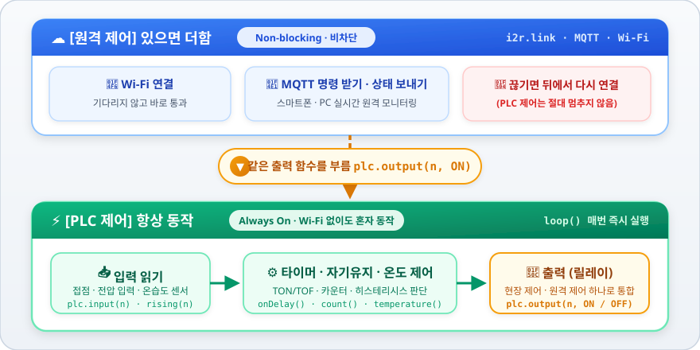

# i2r IoT PLC AI 코딩 키트

**말로 설명하면 AI가 PLC 프로그램을 작성합니다.**

i2r IoT PLC 보드 **i2r-02, i2r-03, i2r-04**(ESP32)를 생성형 AI(Claude, ChatGPT, Gemini 등)와 함께 프로그램하는 저장소입니다.
"입력 1이 들어오면 출력 1을 5초 켜 줘", "온도가 30도를 넘으면 환풍기를 켜 줘"처럼 원하는 동작을 말하면, AI가 이 저장소의 핀 맵과 규칙을 읽고 내 보드에 맞는 코드를 만들어 줍니다.

## ✅ 제작 콘셉트: 원격 제어가 기본, Wi-Fi가 끊겨도 혼자 동작

i2r PLC는 **Wi-Fi로 연결해서 원격으로 제어하는 것을 기본**으로 만든 보드입니다. 스마트폰이나 PC에서 [i2r.link](https://i2r.link)와 MQTT로 입력 상태를 보고 출력을 켜고 끕니다.
하지만 현장에서는 공유기가 꺼지거나 인터넷이 끊길 수 있습니다. 그래서 **Wi-Fi가 연결되지 않아도 PLC로서 혼자(stand alone) 동작**하도록 프로그램을 나누어 구성합니다.

<div align="center">
  
</div>

| 원칙 | 내용 |
|---|---|
| 제어가 먼저 | 입력 → 출력, 타이머, 온도 제어 같은 PLC 동작은 Wi-Fi와 상관없이 `loop()`에서 항상 돕니다 |
| 통신은 기다리지 않음 | Wi-Fi와 MQTT 연결을 기다리며 멈추지 않습니다. 연결이 안 되면 제어는 계속하고, 뒤에서 몇 초마다 다시 연결해 봅니다 |
| 같은 함수로 제어 | 현장의 입력 단자로 켜든, 원격 명령으로 켜든 같은 출력 함수를 씁니다. 그래서 두 방법이 서로 어긋나지 않습니다 |
| 연결되면 다시 맞춤 | Wi-Fi가 다시 연결되면 지금 입력과 출력 상태를 서버에 다시 보냅니다 |
| 끊겨도 안전 | Wi-Fi가 끊겼다고 출력을 함부로 바꾸지 않습니다. 끊겼을 때 꺼야 하는 장치라면 그 동작을 따로 정합니다 |

AI에게 프로그램을 부탁할 때도 이 구조로 만들도록 [AGENTS.md](AGENTS.md)에 적어 두었습니다.

## ✅ 보드

| 보드 | 입력 | 출력(릴레이) | 센서 | 보드 문서 |
|---|---|---|---|---|
| **i2r-02** | 4채널 (무전압 접점) | 4채널 | 없음 | [boards/i2r-02](boards/i2r-02/README.md) |
| **i2r-03** | 4채널 (전압 입력) | 4채널 | AHT21 온습도 | [boards/i2r-03](boards/i2r-03/README.md) |
| **i2r-04** | 8채널 (무전압 접점) | 8채널 | 없음 | [boards/i2r-04](boards/i2r-04/README.md) |

> ⚠️ **i2r-02, i2r-04의 입력은 무전압 접점입니다.** 입력 단자에 따로 전압을 넣으면 보드가 고장 납니다.
> ⚠️ 릴레이에 220V 장치를 연결할 때는 전원을 끄고 배선하세요. 처음에는 장치를 연결하지 않고 릴레이 소리와 LED로 시험하는 것이 안전합니다.

## ✅ AI와 함께 프로그램하기

이 저장소에는 **AI가 읽는 안내서**([AGENTS.md](AGENTS.md))가 들어 있습니다. 보드별 핀, 지켜야 할 규칙, PLC 동작(타이머, 자기유지, 히스테리시스)을 아두이노로 옮기는 방법이 정리되어 있습니다.
두 가지 방법이 있습니다. Claude Code를 쓸 수 있으면 **방법 B**를, 처음이거나 무료로 시작하려면 **방법 A**를 해 보세요.

| | 방법 A: 채팅 (초급용) | 방법 B: Claude Code (중급용) |
|---|---|---|
| 도구 | claude.ai (ChatGPT, Gemini도 가능) + Arduino IDE | VS Code + Claude Code |
| 하는 일 | AI가 코드를 주면 내가 복사해서 업로드 | AI가 코드 작성, 컴파일, 업로드까지 직접 |
| 오류가 나면 | 오류 메시지를 복사해서 AI에게 붙여 넣기 | AI가 스스로 고침 |
| 요금 | 무료 요금제로 시작 가능 | Claude 유료 요금제(Pro 이상) |
| 추천 | 처음 시작하는 사람 | 여러 기능을 만들어 보고 싶은 학생, 실무자 |

### 🤖 방법 B: Claude Code로 하기 (중급용, AI가 업로드까지)

> [!TIP]
> **🤖 Claude가 코드 작성부터 컴파일, 업로드, 시리얼 확인까지 직접 합니다.**
> 나는 하고 싶은 동작을 **한 문장**으로 말하고, 보드가 어떻게 움직였는지 알려 주기만 하면 됩니다.

내가 설치하는 것은 **Git, VS Code, Claude Code 확장** 3개뿐입니다. 빈 폴더를 VS Code로 열고 Claude에게 아래처럼 말하면, 저장소 내려받기와 컴파일 도구·라이브러리 설치까지 Claude가 합니다.

```
https://github.com/kdi6033/i2r 읽고 i2r 개발을 도와줘. plc 개발 환경을 만들어 줘
```

**🔄 새 내용이 추가되면 (최신 내용 받기)**: 처음에 열었던 폴더를 VS Code로 열고 Claude에게 **"저장소를 최신으로 업데이트해 줘"** 라고 말합니다. Claude가 새 내용을 받고, 무엇이 새로 들어왔는지 알려 줍니다. 내가 만든 `my_sketches/`의 프로그램은 그대로 남습니다.

Claude가 이 저장소를 받고 개발 환경을 만듭니다. 이때 내 PC에 **i2r 스킬**을 설치해 두면(Claude가 물어봄), 그다음부터는 어느 폴더에서나 **"plc 개발을 도와줘"** 라고만 말하면 됩니다.
PLC, Otto, 시뮬레이터 모두 같은 한 줄로 시작합니다. ([i2r 안내판](https://github.com/kdi6033/i2r))

> 예전 문장도 계속 됩니다: `https://github.com/kdi6033/i2r-plc 저장소를 이 폴더에 내려받고, 그 안의 CLAUDE.md를 읽은 다음 i2r PLC 개발 환경을 만들어 줘.`

그다음부터는 Claude가 [CLAUDE.md](CLAUDE.md)를 읽고 **코드 작성, 컴파일, 업로드, 시리얼 확인**까지 직접 합니다.
나는 원하는 동작을 말하고, 보드가 어떻게 동작했는지 알려 주기만 하면 됩니다.

```
나: "i2r-03이야. 온도가 30도를 넘으면 출력 1을 켜고, 입력 1을 누르면 강제로 꺼 줘"
Claude: 프로그램 작성 → 컴파일 → "출력 1에 무엇이 연결되어 있나요?" → 업로드 → "릴레이가 켜졌나요?"
```

내가 만든 프로그램은 `my_sketches/` 폴더에 저장됩니다. 이 폴더는 GitHub에 올라가지 않고, 저장소를 업데이트해도 그대로 남습니다.

---

### 방법 A: claude.ai 채팅으로 하기 (초급용, 가장 쉬움)

**처음 한 번 준비**

1. [Arduino IDE 2](https://www.arduino.cc/en/software)를 설치합니다.
2. **보드 매니저**에서 `esp32 by Espressif Systems`(3.0 이상)를 설치합니다. **라이브러리 매니저**에서 `I2R_PLC`를 찾아 설치합니다. (i2r-03 온습도 센서도 이 라이브러리가 읽습니다)
3. **툴** 메뉴에서 보드 설정을 아래처럼 맞춥니다. (세 보드 모두 같음)

| 툴 메뉴 | 값 |
|---|---|
| 보드 | ESP32 Dev Module |
| Flash Size | 8MB (64Mb) |
| Partition Scheme | Huge APP (3MB No OTA/1MB SPIFFS) |

**AI에게 말하기**

[claude.ai](https://claude.ai)를 열고 아래 문장을 복사해서 붙여 넣은 뒤, 보드 이름과 마지막 줄만 내 것으로 바꿉니다.

```
나는 i2r-03 PLC 보드를 가지고 있어.
먼저 https://raw.githubusercontent.com/kdi6033/i2r-plc/main/AGENTS.md 를 읽고, 거기 적힌 핀과 규칙만 써서 아두이노 코드를 만들어 줘.
입력과 출력은 I2R_PLC 라이브러리 함수(plc.input, plc.output)로 써 줘.
나는 초보자니까 코드는 처음부터 끝까지 전체를 주고, 무엇을 하는 코드인지 쉽게 설명해 줘.

만들고 싶은 것: 입력 1이 들어오면 출력 1을 켜고, 5초 뒤에 자동으로 꺼 줘.
```

**반복하기**

1. 받은 코드를 Arduino IDE에 붙여 넣고 **업로드**합니다.
2. 오류가 나면 **오류 메시지 전체를 복사해서** AI에게 붙여 넣습니다.
3. 원하는 대로 동작하지 않으면 **어떻게 동작했는지** 구체적으로 말합니다. (예: "입력을 넣었는데 출력 2가 켜졌어")
4. 잘 되면 다음 기능을 덧붙입니다. (예: "이제 입력 2를 누르면 바로 꺼지게 해 줘")

> ChatGPT, Gemini에서도 같은 문장으로 쓸 수 있습니다. 주소를 읽지 못하는 AI라면 [AGENTS.md](AGENTS.md) 내용을 복사해서 함께 붙여 넣으세요.

> **왜 채팅에서는 이 문장을 쓰나요?** 채팅 AI는 명령을 실행할 수 없어서, 주소를 여러 번 따라가면 중간 내용을 요약만 보고 코드를 짜기도 합니다. 그래서 **PLC만 할 때는** 이 문장처럼 키트의 AGENTS.md 원문 하나를 바로 읽게 합니다.
> Otto, 시뮬레이터까지 함께 하거나 AI가 업로드까지 하게 하려면 위 **방법 B(Claude Code)** 의 안내판 한 줄(`https://github.com/kdi6033/i2r 읽고 i2r 개발을 도와줘`)을 씁니다. Claude Code는 필요한 원문을 모두 직접 읽습니다.

### 🔄 새 내용이 추가되면 (최신 내용 받기)

- **Claude Code (방법 B)**: 처음에 열었던 폴더를 VS Code로 열고 Claude에게 "저장소를 최신으로 업데이트해 줘"라고 말합니다.
- **채팅 (방법 A)**: 할 일이 없습니다. AI가 매번 GitHub의 최신 AGENTS.md를 읽습니다.

## ✅ 예제

| 예제 | 보드 | 내용 |
|---|---|---|
| [i2r02_output_blink](examples/i2r02_output_blink/) | i2r-02 | 출력 1~4를 차례로 1초씩 켜기 |
| [i2r02_input_to_output](examples/i2r02_input_to_output/) | i2r-02 | 입력이 들어오면 같은 번호의 출력 켜기 |
| [i2r03_output_blink](examples/i2r03_output_blink/) | i2r-03 | 출력 1~4를 차례로 1초씩 켜기 |
| [i2r03_input_to_output](examples/i2r03_input_to_output/) | i2r-03 | 입력이 들어오면 같은 번호의 출력 켜기 |
| [i2r03_input_timer](examples/i2r03_input_timer/) | i2r-03 | IN1을 넣으면 OUT1을 5초 켜기 (타이머) |
| [i2r03_temp_relay](examples/i2r03_temp_relay/) | i2r-03 | 30도 이상이면 OUT1 켜고 28도 이하면 끄기 |
| [i2r04_output_blink](examples/i2r04_output_blink/) | i2r-04 | 출력 1~8을 차례로 1초씩 켜기 |
| [i2r04_input_to_output](examples/i2r04_input_to_output/) | i2r-04 | 입력이 들어오면 같은 번호의 출력 켜기 |

모든 예제는 [I2R_PLC 라이브러리](https://github.com/kdi6033/I2R_PLC)를 쓰고, esp32 보드 패키지 3.3.x에서 컴파일을 확인했습니다.
핀 번호 없이 보드 이름만 고르고 `plc.output(1, ON)`처럼 보드에 인쇄된 번호로 씁니다.

```cpp
#include <I2R_PLC.h>

I2R_PLC plc(I2R_03);   // 내 보드: I2R_02, I2R_03, I2R_04

void setup() {
  plc.begin();
}

void loop() {
  plc.update();                  // loop 맨 앞에서 매번
  plc.output(1, plc.input(1));   // IN1이 들어오면 OUT1 켜기
}
```

타이머(TON, TOF), 카운터, 깜빡임, 상태 알림 예제는 [I2R_PLC 예제](https://github.com/kdi6033/I2R_PLC/tree/main/examples)에 있습니다. Arduino IDE에서는 **파일 → 예제 → I2R_PLC**에서 열 수 있습니다.

## ✅ 공식 펌웨어로 되돌리기

내 프로그램을 올리면 공식 i2r 펌웨어(스마트폰 앱, MQTT 원격 제어)가 덮어써집니다. 다시 쓰려면 [i2r.link](https://i2r.link)에서 펌웨어를 다시 설치합니다. 펌웨어 파일은 [download](https://github.com/kdi6033/download) 저장소에도 있습니다.

## ✅ 문서

| 문서 | 내용 |
|---|---|
| [AGENTS.md](AGENTS.md) | AI용 안내서: 보드, 핀 맵, 규칙, 컴파일과 업로드 방법, 문제 해결 |
| [boards/](boards/) | 보드별 사양, 핀 맵, 단자 그림 |
| [examples/](examples/) | 보드별 예제 |
| [i2r 프로토콜](https://github.com/kdi6033/i2r/blob/main/README.md) | MQTT 토픽과 JSON 명령 형식 |

> AI 도구별 안내 파일: Claude Code는 [CLAUDE.md](CLAUDE.md), Codex·Cursor 등은 [AGENTS.md](AGENTS.md), 웹 채팅 AI는 [llms.txt](llms.txt)를 읽습니다. 내용은 모두 AGENTS.md를 기준으로 합니다.

---

[🌐 i2r.link](https://i2r.link) · [🛒 제품 구매](https://i2r.link/products) · [▶️ YouTube](https://www.youtube.com/@i2r-link) · [💻 GitHub](https://github.com/kdi6033)
